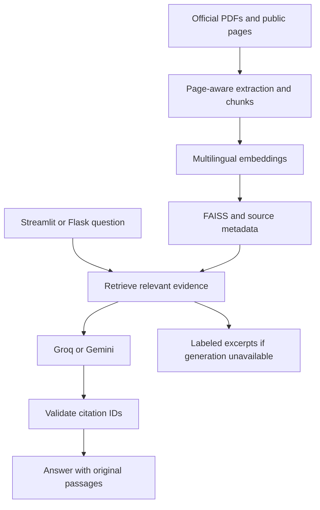
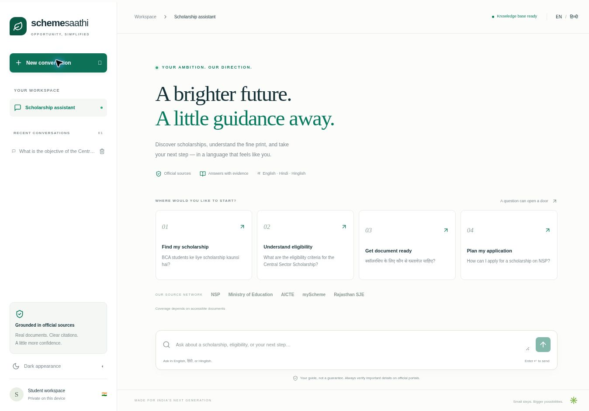

# 🌱 Scheme Saathi
## AI-Powered Scholarship and Government Scheme Assistant

Scheme Saathi helps Indian students find and understand scholarship information using official government documents.

Students can ask questions in **English, Hindi, and Hinglish**. Answers include numbered citations, original source passages, official URLs, and physical PDF page numbers.

> Published guidelines do not confirm current application deadlines or individual eligibility. Always verify important details on official portals.

## Project Status

- Reviewed corpus: **3 official source websites, 2 active PDFs, 1 webpage, and 25 indexed passages**.
- Original interface: **Flask + React**.
- Additional deployment interface: **Streamlit**.
- Existing-project updater: **`update_scheme_saathi.py`**.
- Prepared Streamlit edition: **45 automated tests passed**.
- Hosted Streamlit deployment has not yet been verified.

The Streamlit commands below require `streamlit_app.py` and the updated dependencies. The document updater alone does not install the Streamlit interface.

## Problem Statement

Scholarship information is scattered across government portals and lengthy PDF documents. Students often struggle to understand eligibility criteria, benefits, required documents, and application procedures.

Language barriers and outdated documents make this information harder to use.

## Solution

Scheme Saathi uses Retrieval-Augmented Generation (RAG) to search a reviewed collection of official documents and generate answers supported by retrieved evidence.

When information is unavailable, the assistant explicitly says it was not found. When generation is unavailable, it displays clearly labeled original source excerpts.

## Features

- English, Hindi, and Hinglish questions.
- Retrieval from reviewed official government documents.
- Numbered citations linked to official sources.
- Original source passages and exact physical PDF pages.
- Document dates and current-cycle uncertainty notices.
- Groq and Gemini API adapters.
- Source-excerpt fallback for missing keys or generation failures.
- Streamlit chat interface with suggestions and sidebar history.
- Session-specific conversations and copyable answers.
- Original Flask API and React frontend retained.
- Government-domain allowlist, robots checks, and rate-limited collection.
- Explicit handling of unsupported personal-record questions.

Citation-ID validation checks that cited passages exist. It does not independently prove that every generated claim is supported.

## Technology Stack

| Component | Technology |
| --- | --- |
| Language | Python 3.12 |
| Additional interface | Streamlit |
| Original backend | Flask |
| Original frontend | React, Vite, Tailwind CSS |
| Vector search | FAISS |
| Embeddings | Sentence Transformers |
| Embedding model | paraphrase-multilingual-MiniLM-L12-v2 |
| Model runtime | CPU PyTorch |
| PDF extraction | pypdf |
| Website collection | Requests, BeautifulSoup |
| Answer generation | Groq or Gemini |
| Alternative deployment | Docker / Hugging Face Spaces |

## Official Data Sources

The bundled index contains **25 passages from three official websites**.

| Official website | Included material | Scope |
| --- | --- | --- |
| [National Scholarship Portal](https://scholarships.gov.in/) | PM-USP Central Sector Scholarship guidelines | Four-page PDF; applicability stated from academic year 2022–23 |
| [Kerala Directorate of Technical Education](https://www.dtekerala.gov.in/) | Government-hosted AICTE Sarswati scholarship guidelines | Original 14-page circular retained; physical pages 10–14 indexed |
| [myScheme](https://www.myscheme.gov.in/) | General portal description and discovery information | Public webpage; not a complete copy of its scheme directory |

### Source Limitations

- The included AICTE circular is dated May 2025.
- Sarswati covers girl students in specified BBA/BCA/BMS courses, subject to all other conditions.
- A course name alone does not establish individual eligibility.
- An older July 2019 CSSS PDF is retained with provenance but excluded from default retrieval.
- Current application windows are not established by this corpus.
- Document publication dates, collection timestamps, and application deadlines are different.
- This project does not cover every scholarship on these portals.

Collection outcomes are recorded in `data/collection_report.json`.

## How RAG Works

1. Collect permitted public government documents.
2. Extract PDF text page by page.
3. Create 180-word chunks with 40-word overlap.
4. Generate multilingual embeddings.
5. Store normalized embeddings in FAISS with source metadata.
6. Embed the student's question.
7. Retrieve up to four relevant passages.
8. Ask Groq or Gemini to answer from those passages.
9. Validate citation IDs and display the original evidence.

The embedding model produces 384-dimensional vectors. FAISS uses normalized vectors with `IndexFlatIP`.

Displayed similarity scores are cosine similarity, not eligibility probabilities.

## Architecture



Only the public model and index are shared across Streamlit visitors. Chat messages remain in session-specific state.

Previous messages are not supplied as official evidence; questions are independent.

## Project Structure

```text
Scheme-Saathi/
├── streamlit_app.py
├── START_STREAMLIT.bat
├── .streamlit/
│   ├── config.toml
│   └── secrets.example.toml
├── app.py
├── rag.py
├── embedder.py
├── ingest.py
├── scrape.py
├── update_scheme_saathi.py
├── data/
│   ├── pdfs/
│   ├── scraped/
│   ├── scholarship_sources.json
│   └── collection_report.json
├── index/
│   ├── vectors.faiss
│   ├── metadata.json
│   └── manifest.json
├── frontend/
├── tests/
├── eval/
│   ├── questions.json
│   ├── run_eval.py
│   └── updated_results.json
├── docs/
├── requirements.txt
├── .env.example
├── .gitignore
├── Dockerfile
├── LICENSE
└── README.md
```

### Main Files

| File | Purpose |
| --- | --- |
| `streamlit_app.py` | Streamlit interface using the existing RAG engine |
| `app.py` | Original Flask API |
| `rag.py` | Retrieval, generation, citation checks, and fallback handling |
| `embedder.py` | Multilingual embedding model |
| `ingest.py` | PDF extraction, chunking, and index creation |
| `scrape.py` | Controlled collection of official public sources |
| `update_scheme_saathi.py` | Existing-project backend, document, and index updater |
| `eval/run_eval.py` | Evaluation runner |

## Local Installation — Windows

Use **Python 3.12**.

Open Command Prompt inside the project folder.

### 1. Create a Virtual Environment

```bat
cd /d D:\Scheme-Saathi
py -3.12 -m venv .venv
```

### 2. Install Dependencies

```bat
.venv\Scripts\python.exe -m pip install -r requirements.txt
```

### 3. Create the Environment File

For a new installation:

```bat
copy .env.example .env
notepad .env
```

If `.env` already contains your working configuration, edit that file instead of replacing it.

Example configuration:

```dotenv
LLM_PROVIDER=groq
GROQ_API_KEY=your_private_key_here
GROQ_MODEL=openai/gpt-oss-120b

GEMINI_API_KEY=
GEMINI_MODEL=gemini-2.5-flash

MIN_SCORE=0.35
PORT=7860
```

Use a model available to your provider account. Model availability can change.

The model value must contain only its ID:

```dotenv
GROQ_MODEL=openai/gpt-oss-120b
```

Do not duplicate the assignment inside the value.

For Gemini, set `LLM_PROVIDER=gemini` and configure the corresponding key and model.

**Never commit or share real API keys.**

### 4. Start Streamlit

This requires the Streamlit edition's files and dependencies:

```bat
.venv\Scripts\python.exe -X utf8 -m streamlit run streamlit_app.py
```

Open:

```text
http://localhost:8501
```

Keep the terminal running. Press `Ctrl+C` to stop the application.

After setup, `START_STREAMLIT.bat` provides an alternative Windows launcher.

The first question may take longer while the embedding model downloads or loads.

The reviewed FAISS index is included. Node.js and a React build are not required for the Streamlit interface.

### Without an API Key

The application can retrieve real official passages in **Source excerpts** mode.

Those excerpts remain in their original language and are not presented as generated answers.

## Local Installation — Linux/macOS

```bash
python3.12 -m venv .venv
source .venv/bin/activate
python -m pip install -r requirements.txt
cp .env.example .env
```

Edit `.env`, then start:

```bash
python -m streamlit run streamlit_app.py
```

## Update an Existing Project

`update_scheme_saathi.py` updates the existing project's backend, reviewed documents, and FAISS index.

Place it in the project root beside `app.py`.

Stop the running application before applying the update:

```bat
cd /d D:\Scheme-Saathi
.venv\Scripts\python.exe -X utf8 update_scheme_saathi.py
```

The updater:

- Verifies its embedded update payload.
- Installs updated backend files, documents, and index artifacts.
- Backs up overwritten files.
- Preserves existing `.env` and frontend files.
- Does not install packages or automatically start the server.

Backups are stored under:

```text
.scheme-saathi-backups/
```

If the update has already completed successfully, running it again is unnecessary.

**This updater does not install the Streamlit interface.** The Streamlit entry point and its dependencies must be added separately.

The updater is a maintenance utility; it is not the application entry point for Streamlit Cloud.

## Example Questions

### English

- What is the objective of the Central Sector Scholarship?
- What is myScheme?
- Which documents are mentioned in the available scholarship guidelines?

### Hindi

- सेंट्रल सेक्टर स्कॉलरशिप का उद्देश्य क्या है?
- उपलब्ध दस्तावेजों में पात्रता की क्या शर्तें हैं?

### Hinglish

- BCA students ke liye scholarship kaunsi hai?
- Scholarship ke liye kaunse documents chahiye?
- Sarswati scholarship sirf girls ke liye hai kya?

Answers depend on the indexed evidence.

Personal application status is unavailable because this project does not access student accounts.

## GitHub Upload

Include:

- Application source code.
- `requirements.txt`.
- Reviewed documents and provenance metadata.
- All three index artifacts.
- Tests and evaluation reports.
- README and configuration examples.

Exclude:

```text
.env
.streamlit/secrets.toml
.venv/
__pycache__/
node_modules/
.scheme-saathi-backups/
```

The example files `.env.example` and `.streamlit/secrets.example.toml` must contain no real credentials.

## Deploy on Streamlit Community Cloud

1. Upload the project to GitHub.
2. Open [Streamlit Community Cloud](https://share.streamlit.io/).
3. Create an app from the repository and its actual branch.
4. Set the entry point to:

```text
streamlit_app.py
```

5. Select Python **3.12**.
6. Add your private configuration in the app's Secrets settings:

```toml
LLM_PROVIDER = "groq"
GROQ_API_KEY = "your_private_key_here"
GROQ_MODEL = "openai/gpt-oss-120b"
MIN_SCORE = "0.35"
```

7. Deploy.
8. Test a cited answer, a Hindi question, personal-status abstention, and official-source links before sharing.

Do not use `app.py` or `update_scheme_saathi.py` as the Streamlit entry point.

The hosting environment needs internet access to download the embedding model and contact the LLM provider.

**Deployment status:** configuration is prepared; hosted deployment has not been verified in this workspace.

## Original Flask and React Interface

The original interface remains available as an alternative.

Install Node.js and build the frontend:

```bat
cd frontend
npm ci
npm run build
cd ..
```

Start Flask:

```bat
.venv\Scripts\python.exe -X utf8 app.py
```

Open:

```text
http://127.0.0.1:7860
```

Streamlit calls the RAG engine directly. Starting Streamlit does not start the Flask HTTP API.

## Flask API Documentation

### GET /api/health

Returns application status, index/model readiness, and provider configuration.

Readiness does not guarantee that an external API request will succeed.

### POST /api/ask

Accepts a JSON question of 1–1500 characters.

Example request:

```json
{
  "question": "BCA students ke liye scholarship kaunsi hai?"
}
```

Response fields:

| Field | Description |
| --- | --- |
| `answer` | Generated answer, labeled excerpts, or an explicit unsupported response |
| `sources` | Retrieved passages and provenance |
| `mode` | `rag`, `extractive`, `not_found`, or `refused` |

Source metadata includes:

- Source filename and title.
- Official URL.
- Physical PDF page, or null for HTML.
- Original passage text.
- Cosine similarity score.
- Document date and validity status.
- Collection timestamp where available.

Citation `[1]` refers to `sources[0]`.

### Response Modes

| Mode | Meaning |
| --- | --- |
| `rag` | Provider-generated output passed citation-ID validation |
| `extractive` | Real excerpts shown because generation is unavailable or invalid |
| `not_found` | Supporting information unavailable or request unsupported |
| `refused` | Detected instruction or secret-extraction request |

### HTTP Errors

| Status | Meaning |
| --- | --- |
| 400 | Invalid question |
| 413 | Request body too large |
| 503 | Retrieval index or model unavailable |

## Refresh Sources and Rebuild the Index

```bat
.venv\Scripts\python.exe -X utf8 scrape.py --manifest data/scholarship_sources.json
.venv\Scripts\python.exe -X utf8 ingest.py
```

Stop the application before replacing index files and restart afterward.

Review collection errors, extracted text, document provenance, and applicability before publishing an update.

The collector:

- Uses an explicit government-host allowlist.
- Checks robots rules.
- Rate-limits requests.
- Bounds download sizes.
- Skips access failures and ambiguous robots responses.
- Does not bypass login or CAPTCHA.

Scanned PDFs need a separate OCR workflow.

## Testing and Evaluation

### Automated Tests

The prepared Streamlit edition passed **45 tests**:

- 38 backend and retrieval tests.
- 7 Streamlit tests.

Streamlit checks cover:

- Initial rendering and source summary.
- Real BCA retrieval and source expanders.
- Personal-status abstention.
- New conversations.
- Session isolation.
- Safe runtime errors.
- Official-only citation links.

Testing used Streamlit AppTest. Graphical browser and mobile-device validation are not claimed.

Run:

```bat
.venv\Scripts\python.exe -X utf8 -m pytest -q
```

### Recorded Development Evaluation

The 36-question development evaluation used the 25-passage corpus without a live LLM.

| Metric | Recorded result |
| --- | --- |
| Retrieval hit at 4 | 19/24 answerable questions — 79.17% |
| Negative abstention | 12/12 |
| Applicable citation-ID checks | 100% |
| Extractive verbatim support | 100% |
| Mean warm local latency | 0.0117 seconds |
| P95 warm local latency | 0.0224 seconds |
| Generated-answer faithfulness | Not measured |
| Semantic citation correctness | Not measured |

Results are recorded in:

```text
eval/updated_results.json
```

### Interpretation

- Retrieval checks use hand-authored evidence patterns.
- Verbatim checks verify copied excerpts, not generated-answer correctness.
- Latency excludes model warmup and external API calls.
- These are development results, not hosted performance guarantees.
- BCA regressions informed retrieval changes and are not held-out benchmarks.
- The preceding corpus scored 20/24 on this development set; broad retrieval improvement is not claimed.

Run evaluation:

```bat
.venv\Scripts\python.exe -X utf8 eval\run_eval.py --output eval\local-results.json
```

A configured API key may cause evaluation to call the provider and consume quota.

Independent review is required to measure semantic citation correctness and generated-answer faithfulness.

## Screenshots

These screenshots show the original React interface.

### Landing Screen



### Citation Dialog


Streamlit screenshots will be added after capture from the running interface.

## Docker and Hugging Face Alternative

The existing Dockerfile builds and serves **Flask + React** on port 7860.

```bash
docker build -t scheme-saathi .
docker run --rm -p 7860:7860 --env-file .env scheme-saathi
```

It does not launch Streamlit.

For Hugging Face, use a Docker Space with port 7860 and configure API keys as Space secrets.

Docker and hosted deployment have not been tested in the Streamlit workspace.

## Limitations

- Small curated collection rather than complete scholarship coverage.
- Published guidelines may not describe the current application cycle.
- No private application records or student-account access.
- Citation-ID validation cannot guarantee semantic faithfulness.
- Questions are independent; previous conversations are not evidence.
- Streamlit chat history is session-only and may reset.
- Scanned documents require OCR.
- Model startup, hosting resources, and API quotas affect availability.
- No authentication, durable user database, or production abuse controls are included.

## Future Improvements

- Add independently reviewed state and category-specific sources.
- Introduce monitored document refresh and validity review.
- Improve retrieval with hybrid search and reranking.
- Add OCR for scanned PDFs.
- Expand held-out multilingual evaluation.
- Add independent claim-level citation review.
- Add persistent accounts and history if required.
- Introduce monitoring, quotas, and abuse controls for public hosting.

## License

Project code is available under the MIT License.

Government documents and model weights remain subject to their respective publishers' terms. 