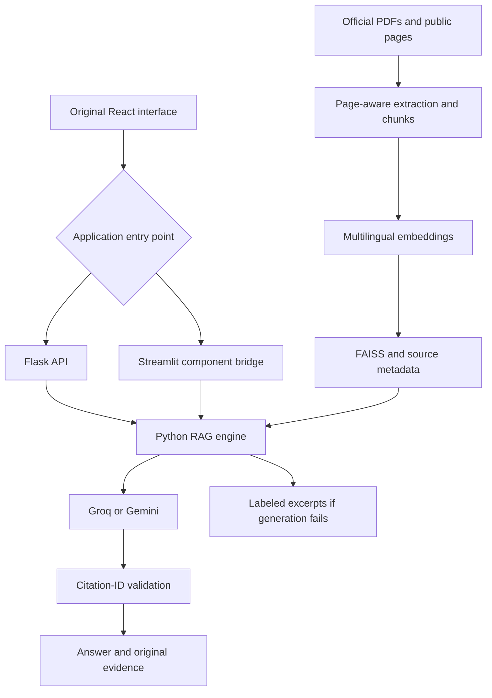
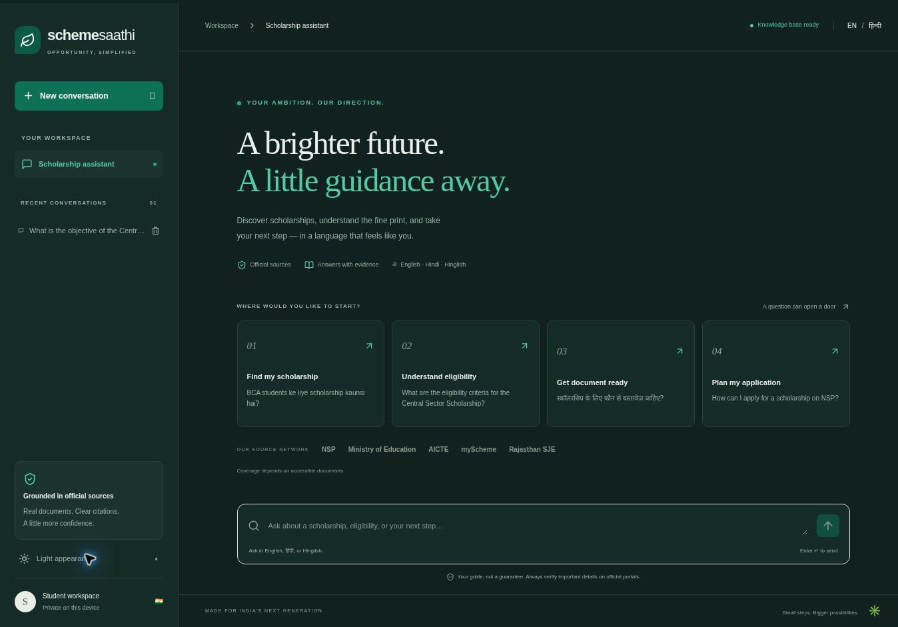
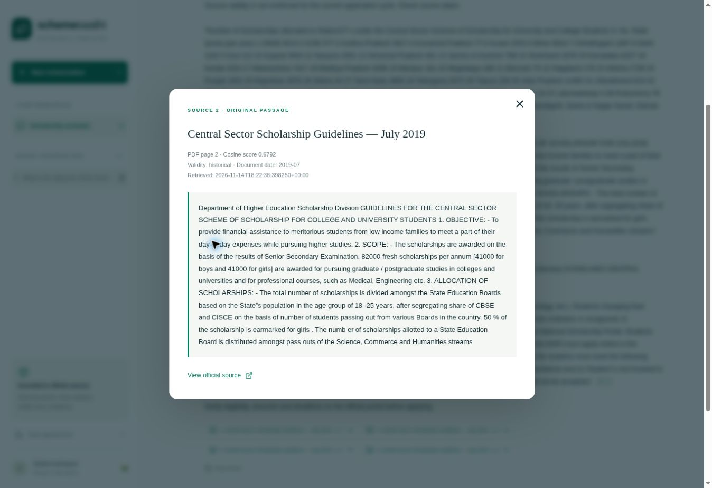

# 🌱 Scheme Saathi
### AI-Powered Scholarship and Government Scheme Assistant

Scheme Saathi helps Indian students understand scholarship information using official government documents.

Students can ask questions in **English, Hindi, and Hinglish**. Answers include numbered citations, original source passages, official URLs, and physical PDF page numbers.

The project includes an original **React interface**, a **Flask API**, and a **Streamlit custom component that preserves the React interface**.

> Published guidelines do not confirm current application deadlines or individual eligibility. Always verify important details on official portals.

## Project Status

- Reviewed corpus: **3 official source websites, 2 active PDFs, 1 webpage, and 25 indexed passages**.
- Original application: **Flask + React**.
- Streamlit version: **original React UI connected to Python through a custom component**.
- Document/backend updater: `update_scheme_saathi.py`.
- React-to-Streamlit builder: `enable_original_ui.py`.
- Compiled Streamlit frontend: `streamlit_ui/`.
- Local layout and scrolling were manually checked during setup.
- Hosted behavior of the final component version has not yet been verified.

## Problem Statement

Scholarship information is scattered across government websites and lengthy PDF documents. Students often struggle to understand eligibility criteria, benefits, required documents, and application procedures.

Language barriers and outdated documents make this information harder to use.

## Solution

Scheme Saathi uses Retrieval-Augmented Generation (RAG) to search a reviewed collection of official documents and generate answers supported by retrieved evidence.

If supporting information is unavailable, the assistant says it was not found. If generation is unavailable, it displays clearly labeled original source excerpts.

## Features

- English, Hindi, and Hinglish questions.
- Retrieval from reviewed official government documents.
- Numbered citations and original source passages.
- Exact physical PDF page numbers.
- Official source links.
- Document dates and current-cycle uncertainty notices.
- Groq and Gemini API adapters.
- Source-excerpt fallback for missing credentials or generation failures.
- Original React interface with dark/light appearance.
- Suggested questions and conversation history.
- Copy-answer controls and citation dialogs.
- Streamlit component bridge connecting React to the Python RAG engine.
- Original Flask API retained.
- Government-domain allowlist, robots checks, and rate-limited collection.
- Explicit handling of unsupported personal-record questions.

Citation-ID validation checks that cited passages exist. It does not independently prove that every generated claim is supported.

## Technology Stack

| Component | Technology |
| --- | --- |
| Programming language | Python |
| Tested Python version | 3.12 |
| Original frontend | React, Vite, Tailwind CSS |
| Backend API | Flask |
| Additional deployment interface | Streamlit custom component |
| Vector search | FAISS |
| Embeddings | Sentence Transformers |
| Embedding model | paraphrase-multilingual-MiniLM-L12-v2 |
| Model runtime | CPU PyTorch |
| PDF extraction | pypdf |
| Website collection | Requests, BeautifulSoup |
| Answer generation | Groq or Gemini API |
| Alternative deployment | Docker / Hugging Face Spaces |

## Official Data Sources

The bundled index contains **25 passages from two active PDFs and one webpage across three official websites**.

| Official website | Included material | Scope |
| --- | --- | --- |
| [National Scholarship Portal](https://scholarships.gov.in/) | PM-USP Central Sector Scholarship guidelines | Four-page PDF; applicability stated from academic year 2022–23 |
| [Kerala Directorate of Technical Education](https://www.dtekerala.gov.in/) | Government-hosted AICTE Sarswati scholarship guidelines | Original 14-page circular retained; physical pages 10–14 indexed |
| [myScheme](https://www.myscheme.gov.in/) | Public portal description and discovery information | General portal information, not a complete scheme directory |

### Source Limitations

- The included AICTE circular is dated May 2025.
- Sarswati guidelines cover girl students in specified BBA/BCA/BMS courses, subject to all other conditions.
- A course name alone does not establish individual eligibility.
- An older July 2019 CSSS PDF is retained with provenance but excluded from default retrieval.
- Current application windows are not established by this corpus.
- Document dates, collection timestamps, and application deadlines are different.
- Portal names displayed in the interface do not imply that every portal or scheme has been ingested.

Collection outcomes are recorded in `data/collection_report.json`.

## How RAG Works

1. Collect permitted public government documents.
2. Extract PDF text page by page.
3. Create 180-word chunks with 40-word overlap.
4. Generate multilingual embeddings.
5. Store normalized embeddings in FAISS with source metadata.
6. Embed the student's question.
7. Retrieve up to four relevant passages.
8. Ask Groq or Gemini to answer from those passages.
9. Validate citation IDs and display the answer with its evidence.

Chunks do not cross physical PDF page boundaries.

The embedding model produces 384-dimensional vectors. FAISS uses normalized vectors with `IndexFlatIP`.

Displayed scores are cosine similarity, not eligibility probabilities.

## Architecture



The Streamlit version embeds the React interface as a bidirectional component. Requests pass to Python through the component bridge rather than a separately running Flask server.

API keys remain on the Python server.

Previous conversation messages are not supplied as official evidence; questions are independent.

## Project Structure

```text
Scheme-Saathi/
├── app.py
├── streamlit_app.py
├── enable_original_ui.py
├── update_scheme_saathi.py
├── rag.py
├── embedder.py
├── ingest.py
├── scrape.py
├── START_APP.bat
├── streamlit_ui/
│   ├── index.html
│   └── assets/
├── frontend/
│   ├── src/
│   │   ├── main.jsx
│   │   └── style.css
│   ├── index.html
│   ├── package.json
│   ├── package-lock.json
│   └── vite.config.js
├── data/
│   ├── pdfs/
│   ├── scraped/
│   ├── scholarship_sources.json
│   └── collection_report.json
├── index/
│   ├── vectors.faiss
│   ├── metadata.json
│   └── manifest.json
├── tests/
├── eval/
│   ├── questions.json
│   ├── run_eval.py
│   └── updated_results.json
├── docs/
├── requirements.txt
├── .env.example
├── .gitignore
├── Dockerfile
├── LICENSE
└── README.md
```

### Main Files

| File / Folder | Purpose |
| --- | --- |
| `app.py` | Original Flask API and React asset serving |
| `streamlit_app.py` | Streamlit entry point and Python component request handling |
| `enable_original_ui.py` | Builds the existing React interface as a Streamlit component |
| `streamlit_ui/` | Compiled HTML, JavaScript, and CSS required for Streamlit deployment |
| `update_scheme_saathi.py` | Existing-project backend, document, and index updater |
| `rag.py` | Retrieval, generation, citation checks, and fallback handling |
| `embedder.py` | Multilingual embedding model |
| `ingest.py` | PDF extraction, chunking, and index creation |
| `scrape.py` | Controlled collection of official public sources |
| `eval/run_eval.py` | Evaluation runner |

## Installation — Windows

Use **Python 3.12**.

Node.js and npm are required when building the React frontend or rebuilding the Streamlit component. They are not required to run an already compiled Streamlit component.

Open PowerShell inside the project folder.

### 1. Create a Virtual Environment

```powershell
cd D:\Scheme-Saathi
py -3.12 -m venv .venv
```

### 2. Install Dependencies

```powershell
.venv\Scripts\python.exe -m pip install -r requirements.txt
```

### 3. Configure Environment Variables

For a new installation:

```powershell
Copy-Item .env.example .env
notepad .env
```

If `.env` already contains working credentials, edit that file instead of replacing it.

Example configuration:

```dotenv
LLM_PROVIDER=groq
GROQ_API_KEY=your_private_key_here
GROQ_MODEL=openai/gpt-oss-120b

GEMINI_API_KEY=
GEMINI_MODEL=gemini-2.5-flash

MIN_SCORE=0.35
PORT=7860
```

Use a model available to your provider account. Availability can change.

Write only the model ID as the value:

```dotenv
GROQ_MODEL=openai/gpt-oss-120b
```

Do not duplicate `GROQ_MODEL=` inside the value.

For Gemini, select `LLM_PROVIDER=gemini` and configure the corresponding key and model.

**Never commit or share real API keys.**

## Run the Original UI Through Streamlit

If `streamlit_ui/index.html` and its compiled assets are included, start directly:

```powershell
.venv\Scripts\python.exe -X utf8 -m streamlit run streamlit_app.py
```

Open:

```text
http://localhost:8501
```

Keep the terminal running. Press `Ctrl+C` to stop the application.

The first question may take longer while the embedding model downloads or loads.

The reviewed FAISS index is included, so ingestion is not required for the initial launch.

### Without an API Key

Document retrieval remains available in **Source excerpts** mode.

These excerpts remain in their original language and are not presented as generated answers.

## Build the Original UI for Streamlit

`enable_original_ui.py` builds the existing React frontend and installs the Streamlit component wrapper.

Place the helper beside `app.py` and run:

```powershell
.venv\Scripts\python.exe -X utf8 enable_original_ui.py
```

The helper:

- Builds a temporary copy of the existing React frontend.
- Adds the React-to-Python component bridge.
- Creates the compiled `streamlit_ui/` folder.
- Updates `streamlit_app.py`.
- Ensures the Streamlit dependency is listed.
- Backs up overwritten files.
- Preserves `.env`, original frontend sources, documents, and the FAISS index.

### Important Rebuild Note

**Rebuilding replaces `streamlit_ui/` and `streamlit_app.py`.**

Manual scrolling, frame sizing, or typography adjustments made to those generated files must be backed up and reapplied after rebuilding.

The working component does not need to be rebuilt before every launch or deployment.

### Interface and Conversation History

The React interface retains its appearance controls, suggestions, citation dialogs, and conversation list.

History is stored in browser local storage where available. It is not a server account or encrypted private record store.

Questions are independent. Previous conversations are not used as official evidence.

## Run the Original Flask and React Application

Build the frontend:

```powershell
cd frontend
npm ci
npm run build
cd ..
```

Start Flask:

```powershell
.venv\Scripts\python.exe -X utf8 app.py
```

Open:

```text
http://127.0.0.1:7860
```

The Flask and Streamlit entry points are alternatives. Starting Streamlit does not start the Flask HTTP API.

## Installation — Linux/macOS

```bash
python3.12 -m venv .venv
source .venv/bin/activate
python -m pip install -r requirements.txt
cp .env.example .env
```

Edit `.env`, then run:

```bash
python -m streamlit run streamlit_app.py
```

The compiled `streamlit_ui/` folder must be present.

## Existing Project Data Update

`update_scheme_saathi.py` updates the backend, reviewed documents, and FAISS index.

Stop running application processes, then run:

```powershell
.venv\Scripts\python.exe -X utf8 update_scheme_saathi.py
```

The updater verifies its payload, backs up overwritten files, and preserves the existing `.env` and frontend source files.

Backups are stored under:

```text
.scheme-saathi-backups/
```

If the update has already completed successfully, running it again is unnecessary.

This updater does not install the Streamlit component. That is the role of `enable_original_ui.py`.

## Example Questions

### English

- What is the objective of the Central Sector Scholarship?
- What is myScheme?
- Which documents are mentioned in the available scholarship guidelines?

### Hindi

- सेंट्रल सेक्टर स्कॉलरशिप का उद्देश्य क्या है?
- उपलब्ध दस्तावेजों में पात्रता की क्या शर्तें हैं?

### Hinglish

- BCA students ke liye scholarship kaunsi hai?
- Scholarship ke liye kaunse documents chahiye?
- Sarswati scholarship sirf girls ke liye hai kya?

Answers depend on the available evidence.

Personal application status is unavailable because the project does not access student accounts.

## Flask API Documentation

### GET /api/health

Returns application status, index/model readiness, and provider configuration.

Readiness does not guarantee that an external API request will succeed.

### POST /api/ask

Accepts a JSON question of 1–1500 characters.

Request:

```json
{
  "question": "BCA students ke liye scholarship kaunsi hai?"
}
```

Response fields:

| Field | Description |
| --- | --- |
| `answer` | Generated answer, labeled excerpts, or an explicit unsupported response |
| `sources` | Retrieved passages and provenance |
| `mode` | `rag`, `extractive`, `not_found`, or `refused` |

Sources include:

- Source filename and title.
- Official URL.
- Physical PDF page, or null for HTML.
- Original passage text.
- Cosine similarity score.
- Document date and validity status.
- Collection timestamp where available.

Citation `[1]` refers to `sources[0]`.

### Response Modes

| Mode | Meaning |
| --- | --- |
| `rag` | Provider-generated output passed citation-ID validation |
| `extractive` | Real excerpts shown because generation is unavailable or invalid |
| `not_found` | Supporting evidence unavailable or request unsupported |
| `refused` | Detected instruction or secret-extraction request |

### HTTP Errors

| Status | Meaning |
| --- | --- |
| 400 | Invalid question |
| 413 | Request body too large |
| 503 | Retrieval index or model unavailable |

The Streamlit bridge handles the interface's health and question requests internally. These are not public Flask HTTP endpoints when only Streamlit is running.

## Refresh Sources and Rebuild the Index

```powershell
.venv\Scripts\python.exe -X utf8 scrape.py --manifest data/scholarship_sources.json
.venv\Scripts\python.exe -X utf8 ingest.py
```

Stop the application before replacing index files and restart afterward.

Review collection errors, extracted text, provenance, and document applicability before publishing an update.

The collector:

- Uses a government-host allowlist.
- Checks robots rules.
- Rate-limits requests.
- Bounds download sizes.
- Skips access failures and ambiguous robots responses.
- Does not bypass login or CAPTCHA.

Scanned PDFs require a separate OCR workflow.

## Testing and Evaluation

### Backend and Retrieval Tests

The three-source backend update passed **38 tests**, including BCA retrieval regressions and PDF-page provenance checks.

Run the tests included in the repository:

```powershell
.venv\Scripts\python.exe -X utf8 -m pytest -q
```

### Original-UI Component Verification

The original React component build completed successfully.

During component development:

- 17 Python backend/component tests passed.
- JavaScript bridge checks passed for request queuing, response mapping, duplicate responses, abort handling, errors, and theme initialization.
- Backend/component unit tests used a controlled engine substitute; they do not prove live LLM correctness.
- Local interface sizing and scrolling were manually checked during setup.

Development checks are not all bundled as repository tests. Hosted rendering, mobile behavior, and live provider reliability require separate verification.

### Recorded Retrieval Evaluation

The 36-question development evaluation used the 25-passage corpus without a live LLM.

| Metric | Recorded result |
| --- | --- |
| Retrieval hit at 4 | 19/24 answerable questions — 79.17% |
| Negative abstention | 12/12 |
| Applicable citation-ID checks | 100% |
| Extractive verbatim support | 100% |
| Mean warm local latency | 0.0117 seconds |
| P95 warm local latency | 0.0224 seconds |
| Generated-answer faithfulness | Not measured |
| Semantic citation correctness | Not measured |

Results are recorded in:

```text
eval/updated_results.json
```

### Evaluation Interpretation

- Retrieval checks use hand-authored evidence patterns.
- Verbatim checks verify copied excerpts, not generated-answer correctness.
- Latency excludes model warmup and external API calls.
- These are development results, not hosted performance guarantees.
- BCA regressions informed retrieval changes and are not held-out benchmarks.
- The preceding corpus scored 20/24 on this development set; broad retrieval improvement is not claimed.

Run evaluation:

```powershell
.venv\Scripts\python.exe -X utf8 eval\run_eval.py --output eval\local-results.json
```

A configured API key may cause evaluation to contact the provider and consume quota.

Independent review is required to measure semantic citation correctness and generated-answer faithfulness.

## Screenshots

These images show the original React interface. Historical source details visible in older screenshots do not establish current scholarship rules.

### Landing Screen


### Dark Interface



### Citation Details



## GitHub Upload

Include:

- Application source code.
- `enable_original_ui.py`.
- The complete compiled `streamlit_ui/` folder.
- `requirements.txt`.
- Reviewed documents and provenance metadata.
- All three index artifacts.
- Tests, evaluation reports, screenshots, and README.

Exclude credentials, environments, caches, and backups.

Example `.gitignore` entries:

```gitignore
.env
.env.*
!.env.example
.venv/
venv/
__pycache__/
.pytest_cache/
*.pyc
*.log
.cache/
node_modules/
frontend/dist/
.streamlit/secrets.toml
.scheme-saathi-backups/
*.zip

!streamlit_ui/
!streamlit_ui/**
```

Example commands after configuring the Git remote:

```powershell
git add README.md enable_original_ui.py streamlit_app.py streamlit_ui requirements.txt .gitignore
git commit -m "Preserve original React UI in Streamlit"
git push
```

Review staged changes before committing. Never include actual API keys.

## Deploy on Streamlit Community Cloud

1. Upload the project and compiled `streamlit_ui/` folder to GitHub.
2. Open [Streamlit Community Cloud](https://share.streamlit.io/).
3. Create an app using the repository and its actual branch.
4. Set the main file path to:

```text
streamlit_app.py
```

5. Select Python **3.12**.
6. Add private configuration in the app's Secrets settings:

```toml
LLM_PROVIDER = "groq"
GROQ_API_KEY = "your_private_key_here"
GROQ_MODEL = "openai/gpt-oss-120b"
MIN_SCORE = "0.35"
```

7. Deploy.
8. Check layout, scrolling, a cited answer, a Hindi question, and unsupported personal-status handling before sharing.

Do not select `enable_original_ui.py`, `update_scheme_saathi.py`, or `app.py` as the Streamlit entry point.

Node.js is not required on Cloud when the compiled component is committed.

Hosting needs internet access to download the embedding model and contact the configured LLM provider.

Hosted behavior of the final component version has not yet been verified.

## Docker and Hugging Face Alternative

The existing Dockerfile builds and serves **Flask + React** on port 7860.

```bash
docker build -t scheme-saathi .
docker run --rm -p 7860:7860 --env-file .env scheme-saathi
```

The Dockerfile does not launch Streamlit.

For a Hugging Face Docker Space, configure the appropriate Space metadata, port 7860, and private API secrets.

Docker deployment has not been verified in the current component setup.

## Limitations

- Small curated collection rather than complete scholarship coverage.
- Published guidelines may not describe the current application cycle.
- No private application records or student-account access.
- Citation-ID validation cannot guarantee semantic faithfulness.
- Questions are independent; previous conversations are not evidence.
- Browser history depends on local storage and is not a secure account system.
- Streamlit iframe restrictions may affect clipboard or browser-specific behavior.
- Frame styling and desktop scaling need checks across browsers and screen sizes.
- Manual generated-file changes are overwritten when the UI helper rebuilds them.
- Scanned PDFs require OCR.
- Model startup, hosting resources, and API quotas affect availability.
- Authentication, durable user storage, and production abuse controls are not included.

## Future Improvements

- Move manual layout fixes into a reproducible component build.
- Test responsive behavior across browsers and mobile devices.
- Add independently reviewed state and category-specific sources.
- Introduce monitored source refresh and validity review.
- Improve retrieval with hybrid search and reranking.
- Add OCR for scanned documents.
- Expand held-out multilingual evaluation.
- Add independent claim-level citation review.
- Introduce monitoring, quotas, and abuse controls for public hosting.

## License

Project code is available under the MIT License.

Government documents and model weights remain subject to their respective publishers' terms.